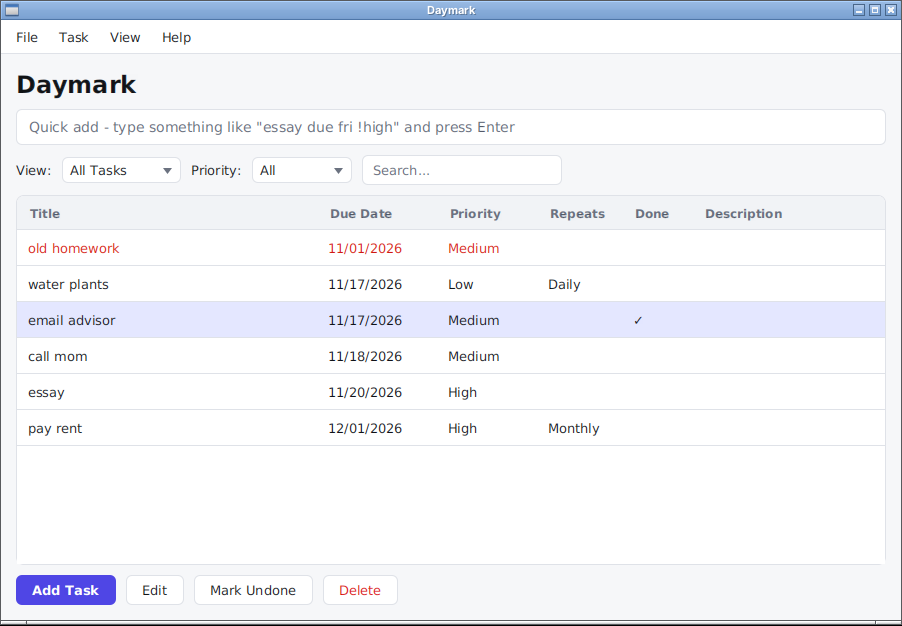
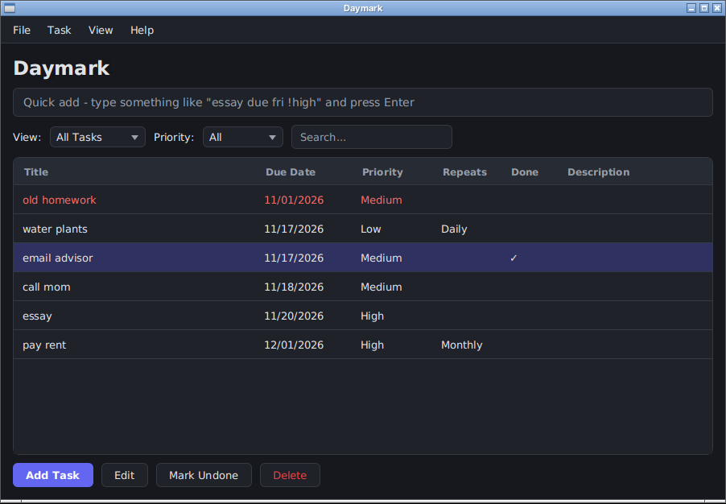

# Daymark

A simple desktop task manager I built with JavaFX and SQLite. I originally had a console
version of this and wanted to turn it into a real GUI app while practicing a layered
architecture inspired by a systems design class.

Built with Java 21, JavaFX, SQLite (JDBC), Maven, JUnit 5 and TestFX.

| Light | Dark |
|---|---|
|  |  |

## What it does

- Add, edit and delete tasks (title, description, due date, priority)
- Mark tasks done / undone
- Switch between Today (due today or overdue), All Tasks and Completed
- Filter by priority and search by text
- Overdue tasks show up in red
- Quick add: type a whole task on one line, like `essay due fri !high`
- Repeating tasks (daily, weekly, monthly) - finishing one creates the next one
- Undo for delete
- Keyboard shortcuts for everything (press F1 in the app for the list)
- Import and export tasks as CSV, and export a `.ics` file to put due dates on a calendar
- Light and dark theme (View > Dark Mode), and it remembers which one you picked
- Everything is saved to a local SQLite file so it persists between runs

## Quick add

Type into the box at the top and press Enter. Anything it doesn't recognize just stays
in the title.

| You type | You get |
|---|---|
| `essay due fri !high` | "essay", due this Friday, high priority |
| `call mom due tomorrow` | "call mom", due tomorrow |
| `pay rent due 12/1 every month` | "pay rent", due Dec 1, repeats monthly |
| `water plants every day !low` | "water plants", due today, repeats daily, low priority |

- Priority: `!high`, `!medium`, `!low` (or `!h`, `!m`, `!l`). Medium if you leave it out.
- Due date: `due today`, `due tomorrow`, `due fri`, `due next week`, `due in 3 days`,
  `due 2026-03-14`, `due 3/14`, `due mar 14`
- Repeating: `every day`, `every week`, `every month`, `every fri`

## Keyboard shortcuts

On a Mac use Cmd instead of Ctrl.

| Keys | What it does |
|---|---|
| Ctrl+N | New task |
| Ctrl+L | Jump to quick add |
| Ctrl+E, or Enter in the list | Edit the selected task |
| Ctrl+D, or Space in the list | Mark done / undone |
| Delete in the list | Delete the selected task |
| Ctrl+Z | Undo the last delete |
| Ctrl+F | Search (Esc clears it) |
| Ctrl+1 / 2 / 3 | Today / All Tasks / Completed |
| Ctrl+Shift+D | Dark mode on / off |
| Ctrl+I | Import CSV |
| Ctrl+S | Export CSV |
| Ctrl+Shift+S | Export calendar (.ics) |
| F1 | Show this list |

## Import and export

- **Export CSV** writes every task to a file you can open in Excel or Google Sheets.
- **Import CSV** adds tasks from a file. It needs a header row with a `title` column;
  `description`, `due_date`, `priority`, `repeats`, `done` and `created_at` are optional.
  Rows with a missing title are skipped, and importing never removes existing tasks.
- **Export Calendar** writes a `.ics` file that Google Calendar, Outlook and Apple Calendar
  can import. Unfinished tasks with a due date become all-day events, and repeating
  tasks become repeating events. It's a one-time copy, not a live sync.

## Running it

You need JDK 21 and Maven.

```
mvn javafx:run
```

Daymark stores its database at `%LOCALAPPDATA%\Daymark\daymark.db`
on Windows, `~/Library/Application Support/Daymark/daymark.db` on macOS, and
`$XDG_DATA_HOME/daymark/daymark.db` (or `~/.local/share/daymark/daymark.db`) on Linux.
An existing database in the user data directory takes precedence. To upgrade an older
installation, launch Daymark from the working directory containing the old `daymark.db`
on the first run. Startup copies and upgrades that database and preserves the original.

## Windows package

With JDK 21 in `JAVA_HOME`, Maven, and WiX Toolset 3 on `PATH`, run
`./scripts/package-windows.ps1 -Type msi` from PowerShell. The installer goes into
`target/dist/`. Use `-Type app-image` to build a self-contained launcher without WiX.
The smoke script runs the launcher against temporary profiles and SQLite fixtures.

```powershell
./scripts/package-windows.ps1 -Type app-image
./scripts/smoke-windows.ps1 -Launcher target/dist/Daymark/Daymark.exe
```

## Tests

```
mvn test
```

Run `mvn test` for the full suite. The UI tests open a real JavaFX window, so on Linux
they need a display server and window manager (CI runs them in Xvfb with Openbox).
The GitHub Actions workflow runs the full suite on Ubuntu 24.04 with JDK 21 and builds,
installs, and smoke-tests a Windows MSI on a fresh Windows 2025 runner. Test and Maven
dependency reports and the MSI are uploaded as workflow artifacts.

There are tests for every layer:

- **Domain** - `TaskTest` and `RecurrenceTest` check overdue logic, that the `with...()`
  methods return copies, and next-due-date math (including a monthly task on the 31st).
- **Persistence** - `SQLiteTaskRepositoryTest` runs against a real in-memory SQLite
  database, including rows with malformed dates written straight into the table.
  `DatabaseManagerTest` covers fresh installs, legacy migration and restart, committed WAL
  rows, and preserving the original when migration fails.
- **Service** - `TaskServiceTest` runs on `InMemoryTaskRepository` instead of SQLite,
  with the date pinned so "today" and "this Friday" always mean the same thing.
  `QuickAddParserTest` covers the quick add syntax, including words that only look like
  keywords.
- **Import / export** - `CsvTasksTest` and `IcsExporterTest` check round trips, escaping,
  and that the calendar file follows the format's rules.
- **UI** - `TaskWorkflowTest` uses TestFX to open the real window and click and type
  through it: adding, editing, deleting and undoing, quick add, keyboard shortcuts,
  dark mode and import/export. It goes through every layer down to the database and
  controls the mouse while it runs.

## Project structure

I split the code into layers on purpose to get some practice with it:

- `domain` - the `Task` record and the `Priority` and `Recurrence` enums, no dependencies on anything else.
  Tasks are immutable, changing one means making a copy with `withTitle(...)` etc.
- `persistence` - `TaskRepository` is the interface the rest of the app uses.
  `DatabaseManager` opens the SQLite connection, creates the table and upgrades older
  database files that are missing newer columns,
  `SQLiteTaskRepository` implements the interface and does the actual SQL. If a stored
  date is malformed the task still loads (without the date) instead of crashing.
- `service` - `TaskService` has the validation rules (empty title, max length etc.)
  and the mark done / undone logic, repeating tasks and undo. The UI only ever talks to
  this layer, and this layer only knows about `TaskRepository`, not SQLite.
  `QuickAddParser` turns a line of text into a task.
- `io` - `CsvTasks` reads and writes CSV, `IcsExporter` writes the calendar file. Both only
  deal with text, so they're tested without touching the disk.
- `ui` - `TaskBrowser` is the main window, `TaskEditor` is the add/edit dialog, `Theme`
  switches between light and dark. All the styling is in `daymark.css`, where each theme
  is just a set of color variables.
- `app` - `DaymarkApplication` just wires everything together and starts JavaFX

## Things I want to add

- Over thanksgiving break, fully scale the architecture and add integrations.
